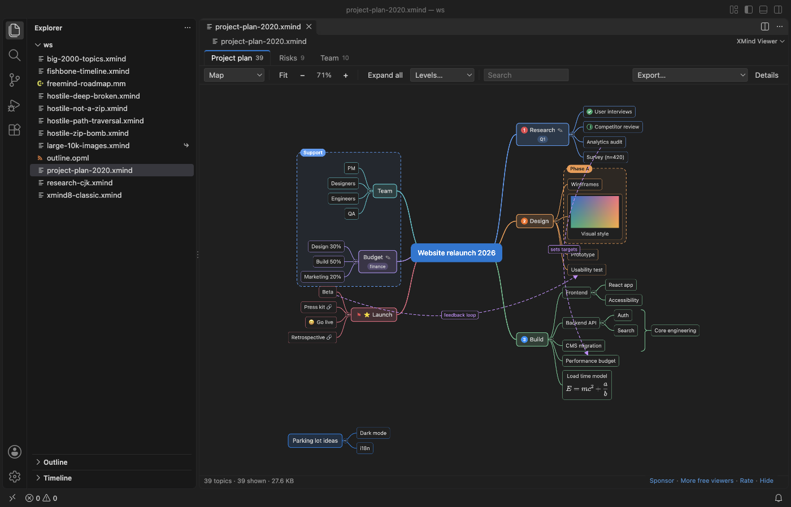
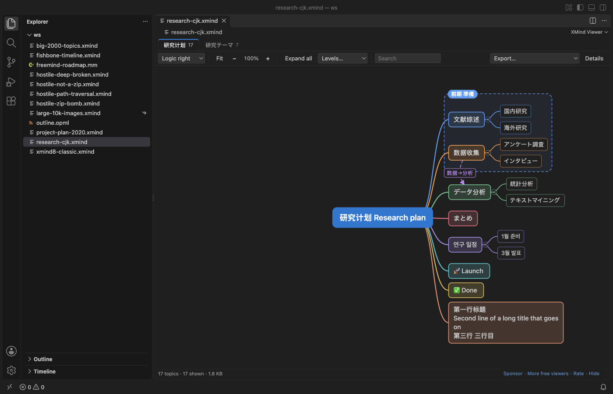
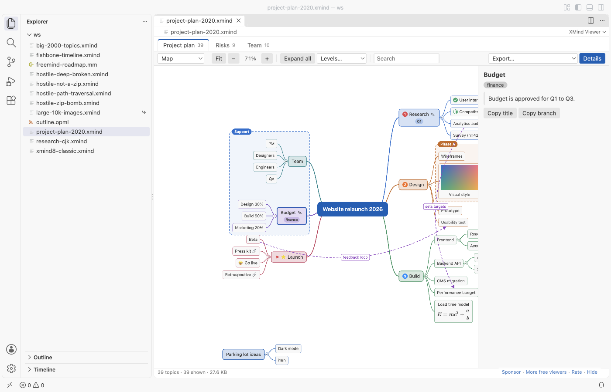
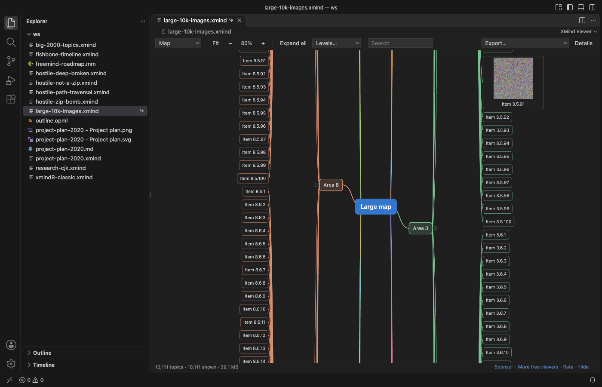
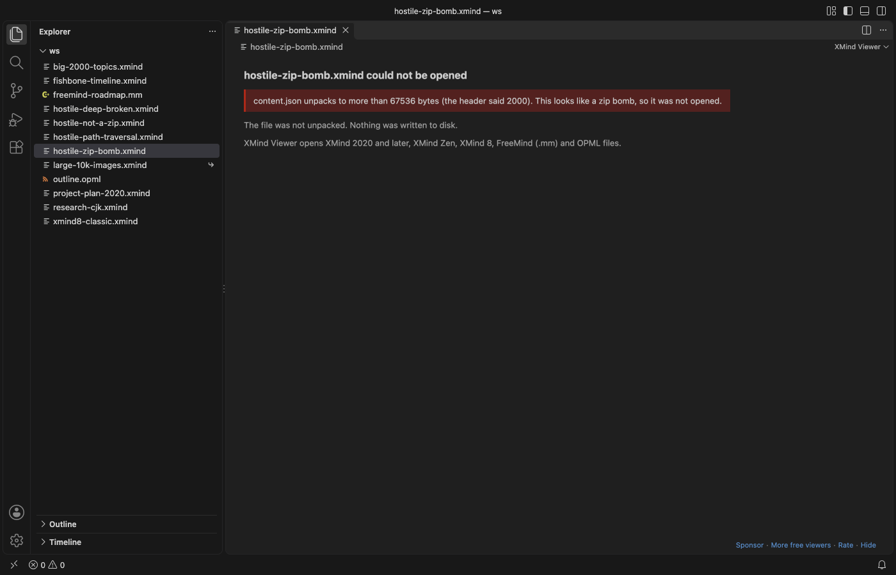

# XMind Viewer & Mind Map Viewer (XMind 8, 2020+)

Open `.xmind` mind maps in VS Code without XMind. Free, no sign-in, works offline: the viewer makes no network requests.

*A real XMind 2020 file (`samples/project-plan-2020.xmind`) in VS Code 1.142, dark theme.*

## What it opens

| File | Made by | What you see |
|---|---|---|
| `.xmind` with `content.json` | XMind 2020 to 2026, XMind Zen | every sheet, all elements below |
| `.xmind` with `content.xml` | XMind 8, XMind 7 and older 3.x files | every sheet, all elements below |
| `.mm` | FreeMind, Freeplane | the map, icons, notes, links, arrow links, clouds |
| `.opml` | outliners, OmniOutliner, Workflowy and others | the outline as a logic chart, with notes |

## Why another XMind viewer

The XMind viewer most people use in VS Code has not changed since 2021, and its open issues are a to-do list. This one fixes them:

1. Every sheet. A file with 3 sheets shows 3 tabs. The old viewer showed only the first sheet ("Can't display multi-pages").
2. XMind 2020 elements. Relationships (curved arrows with their labels), boundaries with titles, summaries with their summary topic, markers (priority, task progress, flags, stars, smileys, arrows), labels, notes, pictures from inside the file, and LaTeX equations drawn with KaTeX.
3. Text that shows. Chinese, Japanese, Korean and emoji titles use your VS Code font with CJK and emoji fallbacks, and long titles wrap.

It is also on Open VSX, so it works in Cursor, Windsurf, VSCodium and other editors based on VS Code.

## Features

- Layouts: map (both sides), logic chart right or left, tree, org chart down or up. Each sheet opens in the layout saved in the file. Fishbone, timeline and matrix sheets are drawn as a logic chart or org chart, and a note tells you so.
- Move and zoom: drag to move, Ctrl or Cmd + wheel (or a pinch) to zoom at the pointer, `F` to fit, `0` for 100%.
- Collapse: click the circle at the end of a branch, double-click a topic or press Space. A collapsed branch shows how many topics it hides. Levels shows only the first 1 to 4 levels. Branches folded in XMind stay folded.
- Search finds topics by title, note, label or equation, also inside collapsed branches, and opens the way to each match.
- Details: click a topic to see its full note, labels, markers by name, the equation and its LaTeX source, and the link.
- Links show a link icon. A click asks first, then opens web and mail links in your browser and file links in VS Code. `xmind:#` links jump to the topic. Other link types are never opened.
- Keyboard: arrow keys move between topics, Space collapses, Ctrl or Cmd + F searches.
- Export: PNG (up to 2x), SVG, the sheet as a Markdown outline on the clipboard, or all sheets as one Markdown file. Your map file is never changed.
- Dark and light: colors come from your VS Code theme and change with it. Topic fill colors saved in the map are used (setting `xmindViewer.useMapColors`).
- Reloads when XMind saves the file again.

## Large maps

A 30 MB `.xmind` with 10,111 topics and 60 pictures opened in VS Code in 0.65 seconds in our test, and collapsing or expanding a branch took 0.2 to 0.4 seconds. Maps with more than 2,500 topics draw only the part near the screen, and far zoomed out they draw boxes without text. The file is read in parts: the viewer reads the ZIP directory from the end of the file, unpacks only the map, and unpacks each picture when it is drawn. Files above 1 GB (setting `xmindViewer.maxFileMB`) show a message instead of a blank tab.

## Safe with files from strangers

- A zip bomb (a 1 MB file that unpacks to 1 GB) is stopped at the size the file says it has, and you see a message. Nothing is unpacked to disk, ever: the viewer only reads into memory.
- Entry names with `..`, absolute paths or drive letters are ignored, and picture links that point outside the package are not read.
- A topic tree 2,000 levels deep and relationships that point to missing topics open with a note instead of a crash.
- The webview has a strict Content Security Policy: no remote scripts, styles, pictures or fonts, and no way to call out.

## Settings

| Setting | Default | What it does |
|---|---|---|
| `xmindViewer.defaultLayout` | `file` | Layout when a sheet opens: the one in the file, or map, logic right or left, tree, org chart |
| `xmindViewer.collapseLevel` | `0` | Collapse branches below this level when a map opens (0 shows all) |
| `xmindViewer.useMapColors` | `true` | Use topic colors saved in the map |
| `xmindViewer.maxFileMB` | `1024` | Largest file that opens |
| `xmindViewer.askForRating` | `true` | Ask one time for a rating after a few good uses |
| `xmindViewer.showSupportLinks` | `true` | Show the small Sponsor and More free viewers links |

## Limits

- Read-only. To change a map, open it in XMind, Freeplane or another editor.
- Maps with a password cannot be opened: XMind encrypts their content. You see a message that says so.
- Fishbone, timeline, matrix and brace sheets are drawn as logic or org charts. Topic positions you dragged by hand in XMind are not kept; the viewer lays out the map itself.
- Styles from XMind themes (fonts, line shapes, topic shapes) are not copied. Topic fill and text colors are.
- In an exported PNG, equations show as their LaTeX source. SVG export keeps them as MathML.

## Privacy

No telemetry, no account, no network. The rating question appears at most twice, only after files opened without errors on two different days, and you can turn it off.

KaTeX (MIT License) draws equations; its files ship inside the extension.

## Support Zovo

Zovo extensions are free, with no ads and no tracking. They are made by [theluckystrike](https://github.com/theluckystrike) on GitHub. If this one saves you time, you can support the work:

- [Sponsor on GitHub](https://github.com/sponsors/theluckystrike)
- [Follow theluckystrike on GitHub](https://github.com/theluckystrike)

## More tools by Zovo

- [Graphviz Viewer & DOT Viewer (Live Preview)](https://marketplace.visualstudio.com/items?itemName=zovo.zovo-graphviz-preview) shows a live preview of DOT files and exports SVG or PNG.
- [Mermaid Viewer & Mermaid Preview](https://github.com/theluckystrike/mermaid-viewer-vscode) shows .mmd files and mermaid blocks in Markdown, offline, with SVG and PNG export.
- [PDF Viewer & PDF Reader](https://marketplace.visualstudio.com/items?itemName=zovo.pdf-viewer-dark) reads PDFs with a real dark mode, search, an outline and thumbnails.
- [DOCX Viewer, Word Viewer & DOCX Preview (Dark Mode)](https://marketplace.visualstudio.com/items?itemName=zovo.docx-viewer-vscode) previews Word and ODT files with dark mode, an outline and search.
- [PPTX Viewer & PPT Viewer, PowerPoint Viewer & Slideshow](https://marketplace.visualstudio.com/items?itemName=zovo.pptx-slide-viewer) shows PowerPoint slides, thumbnails and speaker notes.

See [all Zovo extensions on the Marketplace](https://marketplace.visualstudio.com/publishers/zovo).

## More from zovo

- [All free zovo VS Code extensions](https://marketplace.visualstudio.com/publishers/zovo) — file viewers, database clients, formatters. Offline, no telemetry, no sign-up.
- [Full MCP server catalogue](https://theluckystrike.github.io/mcp/) — local-first MCP servers for back-office work: invoices, VAT, PDFs, spreadsheets, payroll.
- [Hosted no-install MCP endpoints](https://mcp.zovo.one) — paste a URL in Claude / Cursor, nothing to install.
